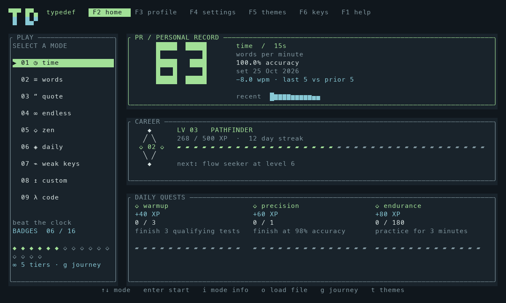

# typedef

Fast, lightweight typing practice in your terminal. Built with Rust and Ratatui.

Practice offline, build a daily habit, and track your speed and accuracy. **v0.5.2** includes nine practice modes, 28 themes, personal records, and an endless progression system. Free and open source.



[Website](https://typedef-cli.vercel.app) · [Contributing](CONTRIBUTING.md) · [Product research](docs/SOURCE_REVIEW.md)

## Get started

### macOS and Linux — one command

```sh
curl -fsSL https://typedef-cli.vercel.app/install.sh | sh
```

Then run `tpdf`. Both `tpdf` and `typedef` open the same app and share your profile.

The [installer](scripts/install.sh) detects Apple Silicon/Intel macOS or ARM64/x86-64 Linux, downloads a prebuilt binary, verifies its SHA-256 checksum, and installs both commands in `~/.local/bin`. It needs `curl`, `tar`, and `shasum` or `sha256sum`; **Rust and sudo are not required**. It does not change your shell configuration. If `tpdf` is not found, run `~/.local/bin/tpdf` or add this to your shell configuration:

```sh
export PATH="$HOME/.local/bin:$PATH"
```

To choose another directory or pin a release:

```sh
curl -fsSL https://typedef-cli.vercel.app/install.sh | sh -s -- --bin-dir "$HOME/bin" --version v0.5.2
```

Re-run the install command to update. Remove the two installed executables to uninstall; your saved profile remains untouched.

### Homebrew

```sh
brew install rawatpriyansh17/tap/typedef
```

This uses the project's [public Homebrew tap](https://github.com/rawatpriyansh17/homebrew-tap) and the same prebuilt releases. It supports macOS and Linux on Apple Silicon/ARM64 and Intel/x86-64. Update with `brew update && brew upgrade typedef`; uninstall with `brew uninstall typedef`.

### Windows and direct downloads

Download the archive for your OS and CPU from [GitHub Releases](https://github.com/rawatpriyansh17/typedef/releases/latest). Windows x86-64 users: extract the ZIP, run `tpdf.exe` in a terminal, and optionally add its folder to PATH. Every archive has a `.sha256` checksum; the release also includes `SHA256SUMS`. macOS binaries target macOS 11 or newer; Linux binaries use a static musl runtime.

### Build from source

Contributors and other platforms can install stable Rust from [rustup.rs](https://rustup.rs), then:

```sh
cargo install --git https://github.com/rawatpriyansh17/typedef --locked
tpdf
```

Cargo installs both commands into `~/.cargo/bin` (Windows: `%USERPROFILE%\.cargo\bin`). For a local checkout:

```sh
git clone https://github.com/rawatpriyansh17/typedef.git
cd typedef
cargo run --release
# Install your local build:
cargo install --path . --locked
```

Choose a mode with arrow keys and press Enter. The timer starts on your first character. Start with 30 seconds, focus on accuracy, and set a daily session goal in Settings.

## Practice modes

Press **I** for the in-app mode guide; browse with ↑↓ and start with Enter. Home shortcuts are **1–9** in this order.

| Mode | How it works | How it ends |
| --- | --- | --- |
| 1 · Time | Generated words; 15/30/60/120-second presets or `--seconds 45`. The first character starts the clock. | At the time limit |
| 2 · Words | 10/25/50/100-word presets or `--words 75`. No time limit. | Last character |
| 3 · Quote | Six original prose passages with capitals and punctuation. | End of passage |
| 4 · Endless | Words keep arriving, with live metrics and repeating 50-word lap progress. The word-count setting does not cap it. | Ctrl+D saves the run |
| 5 · Zen | Unlimited guided words with a quiet focus view. No countdown or word limit; this is not free writing. | Ctrl+D saves the run |
| 6 · Daily | A 60-second challenge seeded by the UTC date. The same app version generates the same initial text offline. Standard difficulty and content settings. | At 60 seconds |
| 7 · Weak keys | Words containing your five most error-prone characters, based on local error rates. Regular words until error history exists. Uses your word-count setting. | Last character |
| 8 · Custom | Your own UTF-8 text or source file. **O** opens the in-app file browser; reuse the last successful import offline. | End of file |
| 9 · Code | Four bundled Rust, Python and JavaScript snippets. Enter types a newline. Tab fills expected leading indentation up to the next four-space tab stop. | End of snippet |

Endless occupies the former Code menu position; Code remains available as mode 9. Existing code-mode history is preserved. Esc abandons an active test without recording it. Endless and Zen still respect difficulty and training settings, so strict rules can fail a run.

## Features

- Normal, expert (fail on an uncorrected error at a space), and master (fail on any mistake) difficulties.
- Optional punctuation and numbers for generated words.
- Live WPM, raw speed, accuracy, and labeled WPM/raw pace charts.
- Whole-word reflow, cached by text and terminal width; long tokens only split when they cannot fit.
- Missed-word retry, blind mode, no-backspace, stop-on-error, and a target-speed caret.
- A PR dashboard with large WPM numerals, recent-run sparklines, and a dedicated records collection grouped by settings.
- Six endless badge tracks with tier rewards, sixteen collectible achievements, daily quests, unlimited levels and recurring Legend cycles.
- A full-width responsive dashboard with a TD monogram, direct keyboard navigation, and clickable header destinations.
- Rank emblems, segmented progress meters, a seven-day habit strip, and PR/level-up result banners.
- A dated activity calendar, historical speed chart for matching settings, and a per-key error heatmap.
- **28 themes** with a responsive preview/apply gallery: Fern, Paper, Moon, Carbon, Tide, Ember, Orchid, Moss, Glacier, Ink, Solar, Terminal, Aurora, Cobalt, Rose, Dune, Lavender, Matcha, Candy, Ocean, Espresso, Copper, Arcade, Blueprint, Cherry, Mint, Amethyst, and Mono.
- QWERTY, Dvorak and Colemak keyboard diagrams with next-key guidance and keypress highlights.
- 28 settings with a live appearance preview: accent overrides, four panel styles, three keyboard styles, three graph markers, bold text, visible rows, caret, spacing, width, focus and live metrics.
- Optional static celebration decorations and a brief visual error pulse. Sound has been removed entirely.
- JSON export and reproducible content seeds for sharing challenges.
- Explicit HTTPS text imports, cached for offline reuse.

## Controls

| Where | Keys | Action |
| --- | --- | --- |
| Home | ↑↓ / j,k; Enter | Pick a mode and start |
| Home / mode guide | 1–9 | Start a mode directly |
| Outside typing / key lab | s / t / p / b / ? | Direct settings / themes / profile / keyboard / help |
| Outside typing | F2 / F3 / F4 / F5 / F6 / F1 | Home / profile / settings / themes / keyboard / help |
| Outside typing | Click a header destination | Switch screens directly |
| Outside typing / key lab | g | Endless journey and badge tracks |
| Outside typing / key lab / results | r | Personal records |
| Typing | Backspace / Ctrl+W | Delete a character / word |
| Typing | Ctrl+R | Start a fresh test |
| Typing | Enter | Type the displayed newline (↵) |
| Endless / Zen | Ctrl+D | Finish and save |
| Code / Custom | Tab | Fill expected leading indentation; never skip code |
| Outside typing / key lab / file picker | i / o | Mode guide / load a local file |
| File picker | ↑↓ / Enter / Ctrl+U | Browse / open folder or file / clear path |
| Results | Enter / r / m / w | New test / same text / missed words / weak-key practice |
| Settings | Tab / Shift+Tab; ↑↓; ←→ | Category / setting / change; saves immediately |
| Themes | Arrows / PgUp / PgDown; Home / End; Enter | Browse; first / last palette; apply explicitly |
| Profile | Tab / Shift+Tab; ↑↓ | Overview / records / history / key heatmap / badges / journey; scroll |
| Anywhere | Esc / Ctrl+C | Home (abandon active test) / quit |

Printable navigation letters remain literal input during practice, in the keyboard lab, and while entering a file path. Function keys or header clicks leave the keyboard lab/file picker; during practice use Esc to abandon before navigating. Leaving Themes discards an unapplied preview. Tab stays local to the current screen.

Bracketed paste is accepted only as a path in the file picker. It is ignored during typing practice and on other screens. Terminals that do not support bracketed paste may deliver pasted text as ordinary keystrokes. Scores are for personal practice, not verified competition.

## Files and online imports

Load a file without restarting: press **O** from a navigation screen, browse with ↑↓ and Enter, or type/paste a path. Absolute paths, paths relative to the displayed folder, and `~/` work. Enclosing quotes are accepted for paths with spaces. Ctrl+U clears the field. A successful import starts Custom practice and replaces the local `import.txt` cache; invalid, empty, oversized, or unreadable files show an error and preserve your previous import. Nothing is uploaded. If Custom has no loaded text, it opens this picker automatically.

```sh
typedef --mode words --words 50
typedef --file src/main.rs
typedef --mode time --seconds 45
typedef --seed 42 --mode words --words 50
typedef --url https://raw.githubusercontent.com/rust-lang/rust/master/README.md
tpdf --mode custom                    # reuse the last in-app/HTTPS import offline
tpdf --mode endless                   # no word or time limit
tpdf --mode code                      # Tab handles indentation
typedef --export > progress.json
typedef --data-dir ./my-profile       # separate profile
```

Downloads require `curl`, HTTPS, and an explicit `--url`; they have a 20-second timeout and a 1 MiB limit. They occur before entering the UI. No text is uploaded. Downloaded text is normalized and stored as `import.txt`. File imports have the same size limit; tabs become four spaces, CRLF becomes LF, terminal control characters and trailing newlines are removed, and leading indentation is preserved. Source code is never executed. `--file` loads for that launch; in-app and HTTPS imports are cached.

Tab expansion in Code/Custom counts each inserted space toward scoring and takes priority over optional Tab-to-restart. Use Ctrl+R to restart either mode.

Local data uses the OS's application-data directory (macOS: `~/Library/Application Support/dev.typedef.typedef`; Linux: `$XDG_DATA_HOME/typedef` or `~/.local/share/typedef`; Windows: the local application-data directory). `TYPEDEF_DATA_DIR` and `--data-dir` override this. `profile.json` contains settings, statistics, and history; back up this file while typedef is closed. An exclusive lock prevents simultaneous writers; saves replace a temporary file. Invalid JSON is reported without overwriting the original.

## How scoring works

A word is five Unicode scalar values, including spaces. WPM counts currently correct positions divided by five and elapsed minutes. Raw WPM counts all character attempts, including corrected ones. Accuracy is correct attempts divided by all attempts: Backspace never erases mistakes from accuracy. Consistency is `100 × (1 − standard deviation / mean)` of sampled cumulative WPM, clamped to 0–100; very short tests have too few samples for a useful estimate.

Successful runs earn `floor(correct characters / 5 × accuracy fraction)` base XP. Every 500 XP adds a level, with ten rank tiers from Seedling to Legend (level 101); levels continue beyond Legend, with a new Legend cycle every 50 levels (101, 151, 201, …). Failed runs earn no XP, quest credit, or badges. Streaks and daily goals use your local calendar date. Personal bests separate mode, duration/word-count, difficulty, punctuation, numbers, and training modifiers, but not individual quotes or custom files; treat mixed-text bests as informal. There is no anti-cheat or competitive leaderboard.

Daily quests add **40 XP** for three qualifying tests, **60 XP** for a qualifying test at 98%+ accuracy, and **80 XP** for three qualifying minutes. Each reward is claimed automatically once per local day and included in the session's XP. Qualifying tests must succeed, last at least ten seconds, and include at least 25 currently correct characters. Historical records without qualification metadata do not retroactively earn quest rewards. The ten new achievements use the same minimum run requirement; the six original achievements retain their existing rules.

The **Journey** (`g`) has six repeating badge tracks. Every tier opens another identical-sized target, with no designed final tier. Each newly crossed tier awards its XP automatically, even when a long run crosses several tiers:

| Track | Requirement per tier | XP per tier |
| --- | --- | --- |
| Rhythm | 10 qualifying tests | 50 |
| Precision | 10 qualifying tests at 98%+ accuracy | 60 |
| Flawless | 10 qualifying tests at 100% accuracy | 80 |
| Endurance | 900 qualifying seconds | 100 |
| Ritual | 5 distinct qualifying local dates | 100 |
| Syntax | 5 qualifying code-mode tests | 75 |

These tracks use the same ten-second / 25-correct-character qualification rule as quests. Ritual counts distinct active dates, not a streak, so a missed day does not erase progress. Tiers are derived from saved history: v0.3 qualifying records count toward your collection, while XP is awarded only for thresholds crossed by new runs. Older records without qualification metadata remain in history and PRs but do not count toward tracks. Rewards are included in each session's XP; restarting the app does not pay old tiers again.

Home compares the last five successful runs against the previous five with matching settings once ten exist. Result screens compare against the previous PR; failed runs never replace a record.

## Development

```sh
rustup component add rustfmt clippy
cargo fmt --check
cargo clippy --all-targets -- -D warnings
cargo test --locked
cargo run
```

See the [source-code review and UI analysis](docs/SOURCE_REVIEW.md), [CONTRIBUTING.md](CONTRIBUTING.md) for a beginner-friendly code map, [research](docs/RESEARCH.md) for the alternatives, and the [roadmap](docs/ROADMAP.md) for the broader vision.

## Display and portability

Settings have four categories: Practice, Appearance, Interface, and Training. Tab switches categories; edits save immediately. In the theme gallery, the focus border and **Preview** label follow your arrows while **Applied** marks the saved theme. Enter applies; Esc closes without saving a pending preview. Custom accents are independent of the theme—choose “theme default” to restore its palette.

Existing profiles retain XP, achievements, history, theme IDs and PR categories. All original twelve theme IDs remain unchanged. New settings receive defaults. Removed sound/volume fields are ignored when loading and omitted on the next save; there is no audio worker, system-player invocation, or bell fallback.

The interface uses the available terminal width instead of a fixed 116-column canvas. Wide dashboards place cards side by side; theme, badge and record grids gain columns. Appearance → Text width also offers **auto (window)** and fixed widths up to 200 columns. Your existing reading-width preference is preserved.

**Text size:** use your terminal emulator's zoom controls (commonly Cmd+ on macOS or Ctrl+Shift+ elsewhere). typedef offers bold text, visible line count, spacing, width, and focus mode. Font size and device vibration are not portable terminal controls. The visual error pulse is optional and suppressed in blind mode; celebrations are static decorations without flashing or motion.

Choose rounded, sharp, double, or borderless panels; filled keycaps, compact tiles, or outlined keys; and Braille, dot, or block graph marks. Large results can be turned off. Keyboard keycaps and live previews adapt to available space, while all essential scores remain visible at 60×20.

Keyboard diagrams are visual guides and do not change your OS input layout. Next-key guidance and error heatmaps use different views. Muted keys mean no observations; green/amber/red represent error-rate bands. Shifted symbols and uppercase letters are grouped under their displayed base key. Real hardware key-release detection is outside the terminal event stream.

`--seed` reproduces content with the same version, mode, punctuation/number settings, and word count. Weak-key mode also depends on your profile, and custom mode depends on its file; seeds alone do not reproduce those sources. Daily overrides training and content modifiers. Sharing a seed does not upload anything or create a verified score.

## Current limits

Use an 80×24 or larger true-color terminal for the best layout. Very small terminals show a resize prompt. Built-in content is English; Unicode files work at the scalar-value level, but grapheme clusters, combining accents, RTL scripts, and IME composition need more work. Code mode currently chooses from a small bundled set. Weak-key practice targets errors, not per-key latency. Zen is guided text, not free writing. There is no account sync, multiplayer, plugin execution, or online ranking yet. Release builds and Rust tests run on macOS and Linux (ARM64 and x86-64), and Windows x86-64. Interactive terminal checks run on macOS and Linux; local visual validation was on macOS. Endless sessions have no designed endpoint, but retain their text and statistics in memory; long-session memory optimization remains on the roadmap.

MIT licensed. Bundled prose, snippets, and the word list were authored for this project; no competitor code or datasets were copied.

On Unix, `python3 scripts/pty_smoke.py` exercises the release binary through a real pseudoterminal, including terminal restoration. Build it first with `cargo build --release`.
